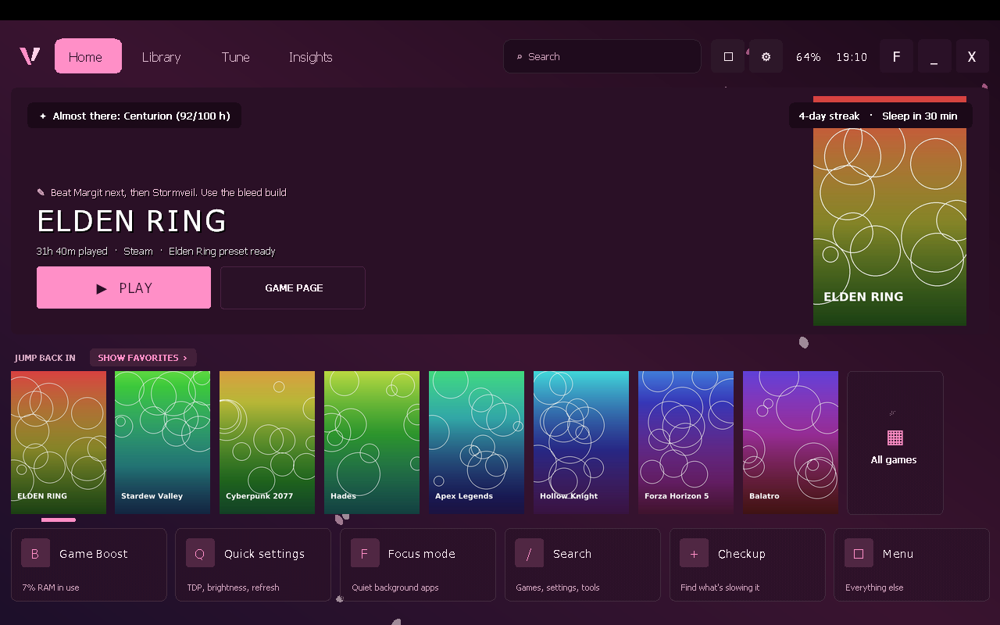
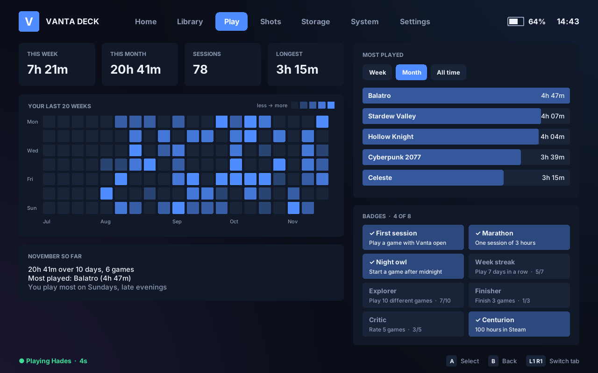
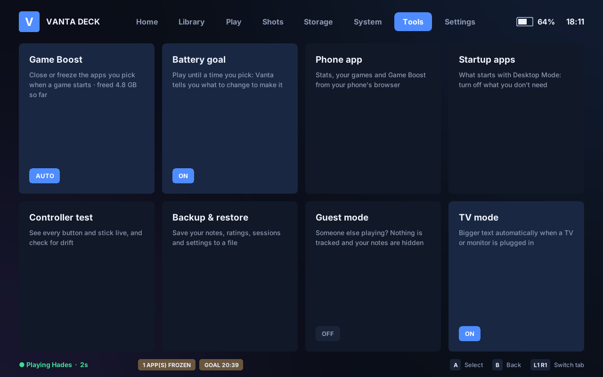

# Vanta

A game hub for handheld gaming PCs. One app for your library, performance, battery and the little things around playing.

| Edition | For | Folder |
|---|---|---|
| **Vanta Go** | Lenovo Legion Go (Windows) | [`windows/`](windows) |
| **Vanta** | Any Windows PC or handheld | [`windows/`](windows) |
| **Vanta Deck** | Steam Deck (SteamOS) | [`steamos/`](steamos) |



## Vanta for Windows (9.9.2)

- **Library from every store:** Steam, Epic, GOG, Xbox, EA, Ubisoft, Battle.net, Amazon, emulators, with covers.
- **Performance:** TDP, Auto TDP, per-game profiles, a battery goal, Game Boost, focus mode.
- **Your play:** game notes, per-game stats, Up next, finished games with ratings, a play calendar, monthly wraps, streaks and badges.
- **Tools:** storage cleanup, leftovers and duplicates, startup speed, battery health, controller tester, dock mode.
- **63 themes**, including animated ones, plus day and night themes and accent colors taken from your game's art.
- **Phone app:** live stats, controls, your games, screenshots, a touchpad and a keyboard, over your home network with a PIN.
- **Guest mode** and **profiles** for sharing the device.

### Build

Needs Windows (or Wine) with Python 3.12, PyInstaller and Pillow.

```
cd windows
build.bat           :: Vanta.exe and VantaGo.exe (run as administrator)
build-preview.bat   :: Preview builds that never change the PC
```

## Vanta Deck for SteamOS (1.2)



- **Library:** Steam games, non-Steam shortcuts, Heroic (Epic, GOG, Amazon) and Lutris games, with search, "Surprise me" and your ratings.
- **Game pages:** Deck Verified and ProtonDB ratings, reviews, news, notes, battery life for that game, its Proton version and launch options, screenshots.
- **Play:** a 20-week play calendar, totals, most played, a monthly wrap and badges.
- **Shots:** all your Steam screenshots, by game.
- **Storage:** cleanup of leftovers from uninstalled games (moved to the Trash), shader caches, and games installed twice.
- **Tools:**
  - **Game Boost:** closes or freezes the apps you pick, automatically when a game starts and when memory runs low. Frozen apps wake up when you stop playing.
  - **Battery goal:** says whether the battery lasts until when you want, and what TDP to set.
  - **Phone app:** stats, your games, Game Boost and screenshots in your phone's browser, behind a PIN.
  - Startup apps, controller test, backup & restore, guest mode, TV mode.
- **67 themes** (all of the Windows ones), 26 animated, with day & night switching.



It doesn't change system settings (TDP, fan and charge limit need the system password on SteamOS). It moves folders to the Trash only when you tap twice, and closes or freezes only the apps you picked.

### Run from source

```
cd steamos
python3 vanta_deck.py      # needs Tk and Pillow
```

### Build a single file

```
pip install pyinstaller pillow
pyinstaller --onefile --windowed --name VantaDeck --hidden-import PIL._tkinter_finder \
  --add-data "vanta-deck.png:." vanta_deck.py
```

Then copy `dist/VantaDeck` and `install.sh` to the Deck and run `install.sh` in Desktop Mode.

## Tests

`tests/windows` drives the whole Windows app under Wine with fake hardware (`autotest.py` taps every button). `tests/steamos` builds a fake SteamOS home (Steam library, art, `/sys` and `/proc`) to run Vanta Deck against.

## Safety

- Controller firmware commands only come from verified sources (the Linux kernel driver and Handheld Daemon). Unknown commands are never sent.
- The Preview builds block everything that would change the PC.
- Backups and settings sync never include keys, tokens or webhooks.
